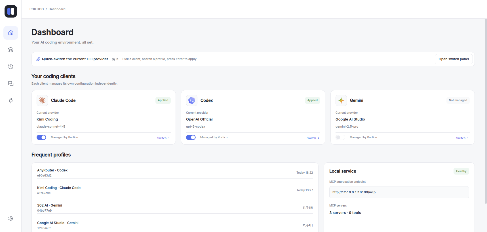
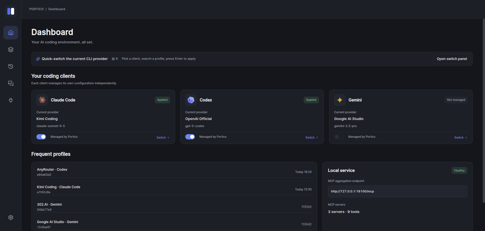
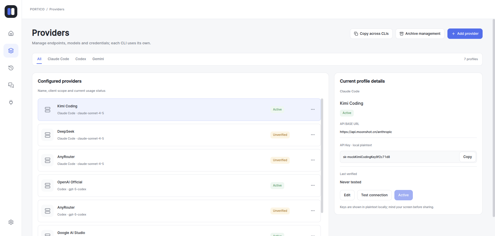
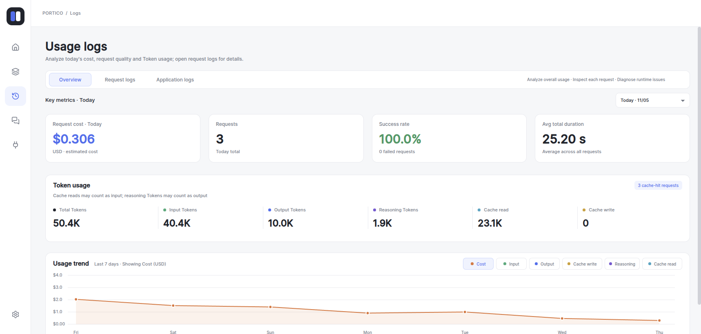
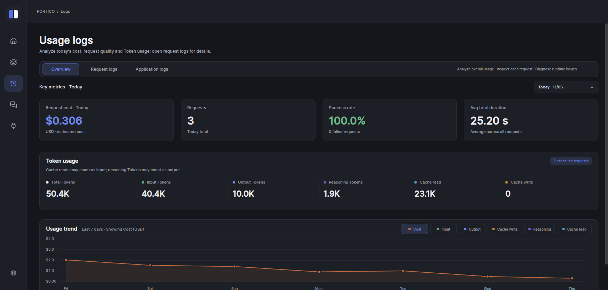
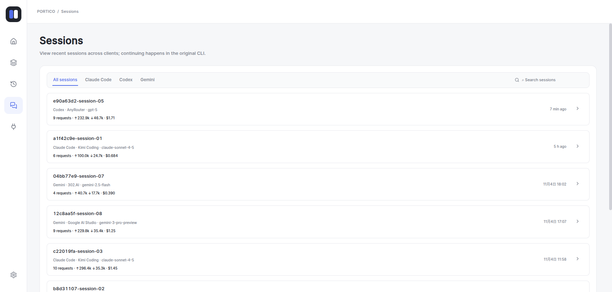
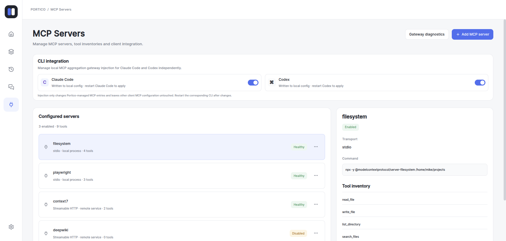

<div align="center">

# Portico

**One local control plane for Claude Code, Codex, and Gemini CLI providers.**

Manage providers, route sessions, inspect usage and costs, and aggregate MCP servers — without changing how you use your CLI tools.

[](https://github.com/blueshark0/Portico/actions/workflows/test.yml)
[](https://github.com/blueshark0/Portico/releases)
[](go.mod)
[](LICENSE)

[Download](https://github.com/blueshark0/Portico/releases) · [Quick start](#quick-start) · [How it works](#how-it-works) · [Development](#development) · [中文文档](README.zh-CN.md)



</div>

## Highlights

- **Unified provider management** — configure API providers for Claude Code, Codex, and Gemini CLI in one desktop app.
- **Session-aware routing** — each platform has a default provider, while active sessions remain bound to the provider that served them.
- **Seamless switching** — change providers for Claude Code and Codex without restarting the CLI.
- **Model controls** — restrict supported models and remap model names, including wildcard mappings such as `claude-*` → `anthropic/claude-*`.
- **Usage and cost visibility** — inspect request logs, token usage, model pricing, costs, and session activity.
- **MCP aggregation gateway** — combine tools from multiple stdio and remote MCP servers behind a single local `/mcp` endpoint.
- **Network flexibility** — configure a proxy per provider, with an explicit opt-in for local TLS interception.
- **Encrypted config sync** — synchronize configuration through WebDAV with encryption.
- **Thoughtful desktop experience** — light/dark themes, English and Chinese interfaces, global hotkeys, and quick switching.

Built with [Wails 3](https://v3.wails.io/), Go, Vue 3, and TypeScript.

## Download

Download the latest package for **macOS** or **Windows** from [GitHub Releases](https://github.com/blueshark0/Portico/releases).

## Quick start

1. **Add a provider** on the Providers page: enter its endpoint, API key, and optional model rules.
2. **Choose a default provider** for each CLI platform you use.
3. **Enable platform access** on the dashboard. Portico updates only the managed fields in the corresponding CLI configuration and points it to the local relay.
4. **Use your CLI normally.** Requests now pass through Portico, which applies provider routing and model mapping automatically.
5. **Optional:** open the MCP page to add upstream servers and inject the aggregated MCP endpoint into Claude Code or Codex.

To disconnect a CLI, disable its platform access in Portico. The original values of fields managed during that session are restored; unrelated CLI configuration is left untouched.

## How it works

Portico runs a local HTTP relay on `127.0.0.1:18100`. Once platform access is enabled, each CLI sends requests to this fixed local address instead of directly to a provider.

```text
Claude Code  ── /v1/messages ───────┐
Codex        ── /responses ─────────┼──▶ Portico local relay ──▶ Configured provider
Gemini CLI   ── /gemini/v1beta/* ───┘         │
                                              ├─ Default provider selection
                                              ├─ Session stickiness
                                              ├─ Model validation and mapping
                                              └─ Usage and cost logging

MCP clients  ─────────────── /mcp ────────────▶ Aggregated upstream MCP tools
```

Routing uses a **default provider plus session stickiness**, not a fallback chain. A new session starts on the platform's default provider and stays with the provider that successfully served it. If that provider is deleted, disabled, or incompatible with the requested model, Portico clears the stale binding and uses the current default provider.

The relay forwards request bodies and responses transparently, removes client credential headers, and injects the selected provider's credentials. Upstream errors are returned to the CLI unchanged.

## More screenshots

<details>
<summary>Dashboard, providers, logs, sessions, and MCP</summary>
<br>

| Dark dashboard | Provider management |
| --- | --- |
|  |  |

| Usage logs | Usage logs in dark mode |
| --- | --- |
|  |  |

| Sessions | MCP servers |
| --- | --- |
|  |  |

</details>

## Local data and privacy

Portico stores application state under `~/.portico/`:

| Path | Contents |
| --- | --- |
| `app.db` | Providers, profiles, preferences, sync settings, and MCP servers |
| `request_log.db` | Request usage and cost logs |
| `session.db` | Session-to-provider bindings |
| `hotkeys.db` | Global hotkey configuration |
| `platformproxy/*.json` | Original values and state of managed CLI configuration fields |

Provider API keys are stored in the local application database. The relay listens on loopback only and requires Portico's local placeholder token. Do not expose the relay to a public network.

## Development

### Prerequisites

- Go **1.26+**
- Node.js **18+** and [pnpm](https://pnpm.io/)
- Wails **3.1.0** CLI:

  ```bash
  go install github.com/wailsapp/wails/v3/cmd/wails3@v3.1.0
  ```

- On Linux: `libgtk-4-dev` and `libwebkitgtk-6.0-dev`

### Run the desktop app

```bash
git clone https://github.com/blueshark0/Portico.git
cd Portico
wails3 task dev
```

The development server supports hot reload.

### Preview the frontend in a browser

No Go backend is required; a mock Wails transport supplies demo data.

```bash
cd frontend
pnpm install
pnpm dev
```

Open `http://localhost:9245`.

### Checks

Run the same core checks used by CI before submitting changes:

```bash
go vet ./...
go test -race -count=1 ./...

cd frontend
pnpm install
pnpm run build
```

### Build and package

```bash
wails3 task common:update:build-assets  # refresh build metadata
wails3 task build                       # build for the current platform
wails3 task package                     # create a production package
```

To publish a tagged release, use `scripts/publish_release.sh v0.1.0`. GitHub Actions also builds release assets from `v*` tags; see [`.github/workflows/release.yml`](.github/workflows/release.yml).

## Project structure

```text
internal/
  app/                 Composition root and desktop shell
  interfaces/          HTTP relay and Wails facades
  routing/             Providers, route profiles, and model mapping
  sessions/            Session-to-provider stickiness
  observability/       Request logs, token parsing, and statistics
  mcpgateway/          MCP aggregation and upstream connections
  platformproxy/       Surgical CLI configuration updates
  configsync/          Encrypted WebDAV synchronization
  shared/              Storage, logging, and background workers
frontend/              Vue 3 + TypeScript desktop interface
resources/             Images and model-pricing data
```

See [CLAUDE.md](CLAUDE.md) for architecture details and development invariants.

## Contributing

Issues and pull requests are welcome. Keep changes focused, include tests for behavioral changes, run the checks above, and update both English and Chinese locale files when changing UI text.

Please report security vulnerabilities privately using the process in [SECURITY.md](SECURITY.md), rather than opening a public issue.

## Acknowledgments

- Desktop application framework: [Wails](https://wails.io/)
- MCP support: [Model Context Protocol Go SDK](https://github.com/modelcontextprotocol/go-sdk)
- Model pricing data: [BerriAI/litellm](https://github.com/BerriAI/litellm)

## License

Portico is licensed under the [Apache License 2.0](LICENSE).
