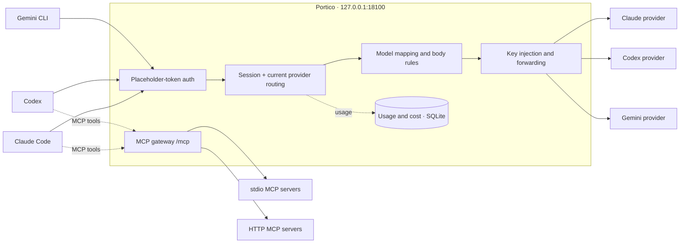

<div align="center">


# Portico

**The API provider control center for AI coding CLIs.**

[Claude Code](https://github.com/anthropics/claude-code) · [Codex](https://github.com/openai/codex) · [Gemini CLI](https://github.com/google-gemini/gemini-cli)

[Download](https://github.com/blueshark0/Portico/releases/latest) · [Quick start](#quick-start) · [How it works](#how-it-works) · [MCP gateway](#mcp-gateway) · [Contributing](#contributing)

**English** · [简体中文](README.zh-CN.md)

[](https://github.com/blueshark0/Portico/actions/workflows/test.yml)
[](LICENSE)


</div>

Portico is a cross-platform desktop app that sits between your AI coding CLIs and their API providers. It runs a local relay on `127.0.0.1:18100`, points each CLI at it, and forwards requests to the provider you choose — with session-aware routing, model remapping, per-request usage and cost tracking, and an aggregated MCP endpoint.

- **One local address for every CLI.** Switch providers in the app or with the <kbd>⌘K</kbd> / <kbd>Ctrl+K</kbd> palette, without editing CLI config files again.
- **Routing you can reason about.** Each CLI has a current provider, and a session stays with the provider that served it. No hidden retry chains, no silent fallbacks.
- **Know what you spend.** Tokens, cache reads and writes, estimated cost, time to first response and total duration for every request.
- **Transparent by design.** Requests and responses — including SSE streams — are forwarded byte for byte. Only the `model` field and your own body-rewrite rules touch the payload.
- **Careful with your configs.** Portico patches only the fields it manages, keeps their previous values, and restores them when you turn integration off.

Built with [Wails 3](https://v3.wails.io) (Go) and Vue 3 + TypeScript. All data stays on your machine.

## Preview


<details>
<summary>More screenshots — dark mode, providers, usage logs, sessions, MCP servers</summary>
<br />


</details>

## Features

| | |
| --- | --- |
| **Provider management** | Separate provider profiles per CLI, quick switching with <kbd>⌘K</kbd> / <kbd>Ctrl+K</kbd>, connection tests, copying profiles across CLIs, and archive / restore. |
| **Predictable routing** | A session is bound to the provider that served it. Switching the current provider affects new sessions; an invalid binding (provider deleted, archived, or unable to serve the model) is cleared and re-bound automatically. |
| **Model control** | Per-provider model allowlists (exact or wildcard), named **model mapping schemes** you can save and switch between (`claude-*` → `anthropic/claude-*`), and request-body override / conditional-replace rules. |
| **Networking** | Global HTTP proxy with per-provider inherit / custom / direct overrides, and an explicit, per-provider TLS-skip option for local intercepting proxies. |
| **Usage & cost** | Per-request log with tokens, cache, cost, first response time, duration and status; an overview dashboard with success rate, token breakdown and a 7-day trend; per-session traces; application logs. |
| **MCP gateway** | Aggregate stdio and Streamable HTTP MCP servers behind one endpoint (`/mcp`) with namespaced tools (`<server>__<tool>`), per-upstream call timeouts, connection tests and diagnostics, and one-click injection into Claude Code and Codex. |
| **Sync & preferences** | Optional WebDAV sync of provider profiles and appearance preferences, encrypted client-side (scrypt + AES-256-GCM) with local backups before a restore; light / dark / system theme, English and Chinese UI. |
| **Desktop shell** | System tray with light and dark icons, and dock visibility control on macOS. |

## Supported clients

| CLI | Relay endpoints | Managed config fields | MCP injection |
| --- | --- | --- | --- |
| **Claude Code** | `POST /v1/messages` | `~/.claude/settings.json` → `env.ANTHROPIC_BASE_URL`, `env.ANTHROPIC_AUTH_TOKEN` | `~/.claude.json` → `mcpServers.portico` |
| **Codex** | `POST /responses`, `POST /responses/compact` | `~/.codex/config.toml` → `model_provider`, `model_providers.portico.*`; `~/.codex/auth.json` → `OPENAI_API_KEY` | `~/.codex/config.toml` → `[mcp_servers.portico]` |
| **Gemini CLI** | `POST /gemini/v1beta/*`, `POST /gemini/v1/*` | `~/.gemini/.env` → `GOOGLE_GEMINI_BASE_URL`, `GEMINI_API_KEY` | — (connect it manually, see [MCP gateway](#mcp-gateway)) |

The CLIs authenticate to the relay with the placeholder token `portico`, never with your real key. Portico strips client credentials and injects the selected provider's API key on the outbound request only. The relay listens on loopback and is not exposed to your network.

## Installation

Grab a build from [**Releases**](https://github.com/blueshark0/Portico/releases/latest).

| Platform | Asset |
| --- | --- |
| macOS · Apple Silicon | `portico-macos-arm64.zip` |
| macOS · Intel | `portico-macos-amd64.zip` |
| Windows · x64 installer | `Portico-amd64-installer.exe` |
| Windows · x64 portable | `Portico.exe` |
| Linux | [Build from source](#building-from-source) |

**macOS.** Unzip and move `Portico.app` to `/Applications`. Release builds are ad-hoc signed, not notarized, so Gatekeeper may refuse the first launch:

```sh
xattr -cr /Applications/Portico.app
```

…or approve the app once under *System Settings → Privacy & Security*.

**Windows.** The NSIS installer bootstraps the WebView2 runtime if needed; the portable executable requires WebView2 to be installed already.

**Upgrading from Code Switch.** On first launch Portico renames `~/.code-switch` to `~/.portico`, keeping your profiles, request logs and proxy state (an existing `~/.portico` is never touched). The legacy `code-switch` placeholder token is still accepted, so an existing CLI integration keeps working; re-enable it once to move fully to the new placeholder.

## Quick start

1. **Add a provider** under *Providers → Add provider*: a name, the CLI it belongs to, its API base URL and API key. *Test connection* checks reachability without sending credentials or consuming API quota.
2. **Make it current** with *Set as current*, or pick it from the <kbd>⌘K</kbd> / <kbd>Ctrl+K</kbd> palette.
3. **Enable integration** for that CLI on the Dashboard with the *Managed by Portico* toggle. Portico rewrites only the fields listed above and stores their previous values.
4. **Restart the CLI** if it was already running, then work as usual. Every request now flows through Portico.

After that, switching providers is an in-app action — no config editing, no restart. Note that an **existing session keeps its provider**; switching affects new sessions. To move a live session, use *Sessions → Unbind session*, or start a new session in the CLI.

Turning the toggle off restores the previous values. Provider names and API keys are stored locally in `~/.portico/app.db`.

## How it works



Each request goes through five steps:

1. **Authenticate.** The inbound token must be the `portico` placeholder (`Authorization`, `X-Api-Key`, `X-Goog-Api-Key` or `?key=`); anything else gets a `401`.
2. **Resolve.** The session's bound provider wins; otherwise the CLI's current provider is used. A request whose model the provider does not allow is rejected rather than silently rerouted. Upstream errors are returned verbatim and never bind a session.
3. **Rewrite.** The requested model is mapped to the provider's own model name, and your body-rewrite rules are applied. The body stays raw bytes throughout — unknown fields are preserved.
4. **Forward.** Client credentials are stripped, the provider key is injected, and the request goes out through a shared HTTP client using the provider's proxy and TLS settings. Cancelling the CLI request cancels the upstream one.
5. **Record.** Token usage is parsed from SSE `data:` lines or the response JSON without altering the stream, and written to `request_log.db` in the background. Cost is estimated from the bundled pricing table.

### What changes on disk

Integration is opt-in per CLI and reversible. Portico uses field-level patches — raw JSON edits for Claude Code, AST-offset edits for Codex TOML, line edits for Gemini dotenv — so unrelated keys, ordering and comments survive. Previous values live in `~/.portico/platformproxy/<platform>.json` (mode `0600`, since a snapshot may contain an old API key) and are restored when you disable integration.

## MCP gateway

Portico also aggregates your MCP servers into a single Streamable HTTP endpoint, so every CLI shares one tool inventory instead of each running its own copies.

| | |
| --- | --- |
| **Endpoint** | `http://127.0.0.1:18100/mcp` (POST / GET / DELETE) |
| **Auth** | `Authorization: Bearer portico` |
| **Upstreams** | `stdio` (command, args, env) or `http` (Streamable HTTP URL, headers) |
| **Tool naming** | `<server>__<tool>`, e.g. `context7__resolve-library-id`; names over 64 chars get a hash suffix |
| **Safety** | Upstream headers are only sent to the host they were configured for, so a redirect cannot exfiltrate credentials. Server names may not contain `__`. |

1. Add servers on the **MCP Servers** page, test the connection, and enable them.
2. Turn on CLI injection for **Claude Code** and **Codex**; only the `portico` entry is touched, your own MCP entries are left alone. Restart the CLI to pick it up.
3. Use **Gateway diagnostics** to inspect upstream health, latency, tool schemas and downstream naming.

For any other MCP client that supports Streamable HTTP, connect manually to the endpoint above with the bearer header. Enabled upstreams and their tools are visible downstream immediately, and upstream `tools/list_changed` notifications refresh the registry without a reconnect.

## Data & privacy

Everything lives in `~/.portico/` on your machine:

| Path | Contents |
| --- | --- |
| `app.db` | Provider profiles and API keys, preferences, WebDAV settings, MCP servers |
| `request_log.db` | Per-request usage records, retained for **30 days** |
| `session.db` | Session → provider bindings |
| `hotkeys.db` | Hotkey settings |
| `platformproxy/<platform>.json` | Previous values of managed CLI config fields (`0600`) |
| `app.log` | Rotating application log (10 MB, 5 backups, 14 days) |
| `sync-backups/` | Local snapshots taken before a cloud restore |

- **API keys are stored in plaintext** in the local SQLite database, and the UI displays them so you can copy and edit them. Protect your user account accordingly.
- **No telemetry.** Portico has no analytics, update pinging or hard-coded service endpoints. Network traffic goes only to the providers, MCP upstreams and WebDAV server you configure.
- **No request contents.** Only structured metrics are logged — never prompts, completions or raw SSE events. Costs are estimates in USD from the bundled pricing table, not your provider's invoice.
- **WebDAV sync is optional** and off until you configure it. Snapshots are encrypted on your machine with your passphrase before upload.

Report vulnerabilities privately — see [SECURITY.md](SECURITY.md).

## Troubleshooting

<details>
<summary><strong>The CLI gets 401 from the relay</strong></summary>

Its config no longer carries the `portico` placeholder — usually because another tool rewrote the file. Toggle the CLI's integration off and on again on the Dashboard. This only fixes the managed fields; your other settings are untouched.
</details>

<details>
<summary><strong>The app exits right after starting</strong></summary>

The relay needs `127.0.0.1:18100`, and the port is fixed. Check whether another Portico instance or a different relay is holding it, then check `~/.portico/app.log`.
</details>

<details>
<summary><strong>I switched providers but the session still uses the old one</strong></summary>

That is session stickiness working as intended. Use *Sessions → Unbind session* to re-route it to the current provider, or start a new session in the CLI.
</details>

<details>
<summary><strong>A provider is skipped or a model is rejected</strong></summary>

Check the provider's supported-model allowlist and the active mapping scheme. An empty allowlist with no mappings accepts every model; a populated one only accepts what it lists.
</details>

<details>
<summary><strong>Costs or token counts look off</strong></summary>

Costs are derived from the bundled LiteLLM price table and may differ from your provider's billing, especially for cached or reasoning tokens. Total tokens = input + output; cache and reasoning tokens may already be included in those numbers.
</details>

**Debug logging:** set `PORTICO_DEBUG_RELAY=1` before launching Portico for verbose per-request relay logs. *Usage logs → Application logs* shows startup, MCP connection and upstream errors.

## Development

### Prerequisites

- **Go 1.26+**
- **Node.js 20.19+ or 22.12+** (required by Vite 7) with **pnpm 9**
- **Wails 3.1.0 CLI**

  ```sh
  go install github.com/wailsapp/wails/v3/cmd/wails3@v3.1.0
  ```

- **Linux only:** `libgtk-4-dev` and `libwebkitgtk-6.0-dev`

  ```sh
  sudo apt-get install -y libgtk-4-dev libwebkitgtk-6.0-dev
  ```

### Building from source

```sh
git clone https://github.com/blueshark0/Portico.git
cd Portico

wails3 task dev       # desktop app with hot reload
wails3 task build     # build for the current platform
wails3 task package   # production packaging (.app / NSIS / AppImage + deb + rpm)
```

Frontend dependencies and Wails bindings are generated by the build tasks. To regenerate bindings by hand after changing Go structs or methods exposed to the UI:

```sh
wails3 task common:generate:bindings
```

**Browser-only frontend preview** — no Go backend needed; the UI detects the missing Wails runtime and serves demo data through a mock transport:

```sh
cd frontend
pnpm install
pnpm dev              # http://localhost:9245
```

### Checks

These are exactly what CI runs on every push and pull request:

```sh
go vet ./...
go test -race -count=1 ./...

cd frontend
pnpm install --frozen-lockfile
pnpm run build        # vue-tsc type-check + production Vite build
```

Go tests must never touch the real `~/.portico`; they use isolated per-test databases. Run `go test -race` whenever you change the relay, the session cache or the MCP gateway.

### Packaging and releasing

Update build metadata before packaging:

```sh
wails3 task common:update:build-assets
wails3 task package
```

Cross-compile Windows from macOS with `mingw-w64` (`brew install mingw-w64`):

```sh
env ARCH=amd64 wails3 task windows:build
env ARCH=amd64 wails3 task windows:package   # requires makensis
```

Pushing a `v*` tag triggers [`.github/workflows/release.yml`](.github/workflows/release.yml), which builds macOS (arm64, amd64) and Windows (amd64) artifacts and publishes a release. `scripts/publish_release.sh <tag> [notes-file]` is the equivalent local entry point.

## Project structure

```
main.go                              Wails entry point; delegates to the container
internal/
  app/bootstrap/                     composition root, storage init and migrations
  app/desktop/                       window, tray and dock shell
  interfaces/http/relay/             loopback relay: auth, routing, forwarding, MCP mount
  interfaces/wails/                  facades exposed to the frontend
  routing/                           providers, route profiles, model mapping schemes, probes
  sessions/                          session → provider stickiness (LRU + SQLite)
  observability/                     request logs, token parsing, stats, app log reader
  platformproxy/                     surgical CLI config edits, MCP injection, restore
  mcpgateway/                        upstream pool, tool registry, aggregation
  configsync/                        encrypted WebDAV config sync
  hotkeys/                           hotkey storage
  shared/                            kernel types, storage, logging, background worker
resources/model-pricing/             bundled pricing table and cost calculation
frontend/                            Vue 3 + TypeScript + Vite + Tailwind UI
build/                               per-platform packaging configuration
```

The backend is organized into bounded contexts under `internal/`, each split into `domain / application / infrastructure`, with dependencies pointing inward (`interfaces → application → domain`). New services are wired in `internal/app/bootstrap/container.go`. Frontend state lives in feature composables; there is no store framework.

## Contributing

Contributions are welcome.

- **Bugs and ideas:** use the [bug report](https://github.com/blueshark0/Portico/issues/new?template=bug_report.yml) and [feature request](https://github.com/blueshark0/Portico/issues/new?template=feature_request.yml) templates. For anything non-trivial, open an issue first so the approach can be discussed before you invest time.
- **Before opening a PR:** run the [checks](#checks) above. Keep commits focused and use [Conventional Commits](https://www.conventionalcommits.org/) prefixes (`feat:`, `fix:`, `docs:`, `refactor:`, `test:`, `chore:`).
- **User-facing text** must be added to both `frontend/src/locales/en.json` and `zh.json`, keeping the key sets symmetric.
- **Relay changes** must preserve byte-level passthrough of requests and responses; extend the existing passthrough tests rather than weakening them.
- **Security issues** should be reported privately, not as public issues — see [SECURITY.md](SECURITY.md).

## Acknowledgements

- [Wails](https://v3.wails.io) — desktop application framework
- [BerriAI/litellm](https://github.com/BerriAI/litellm) — source of the bundled [model pricing data](resources/model-pricing/model_prices_and_context_window.json)
- [modelcontextprotocol/go-sdk](https://github.com/modelcontextprotocol/go-sdk) — MCP server and client implementation behind the gateway

Portico is an independent open-source project and is not affiliated with, endorsed by, or sponsored by Anthropic, OpenAI or Google. Claude Code, Codex and Gemini are trademarks of their respective owners.

## License

[Apache License 2.0](LICENSE) © Portico contributors
