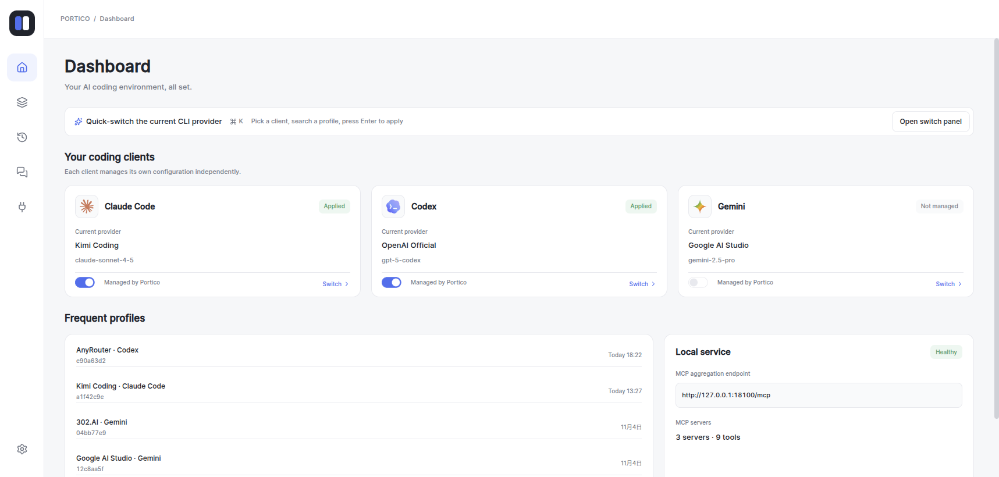
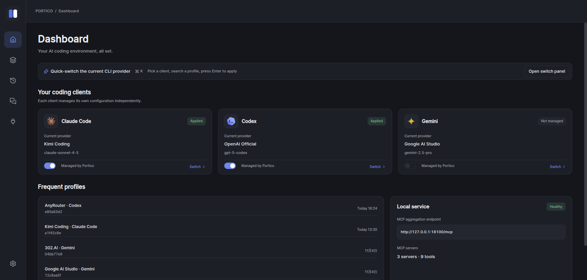
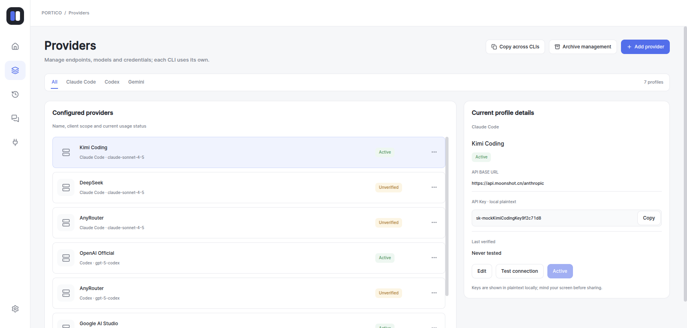
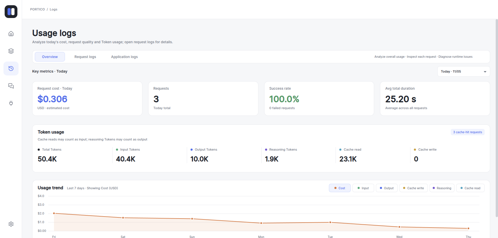
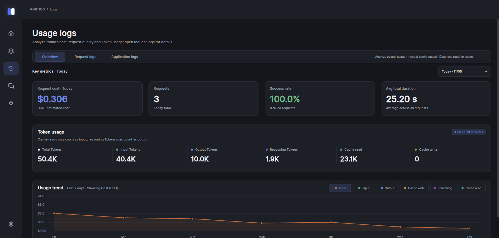
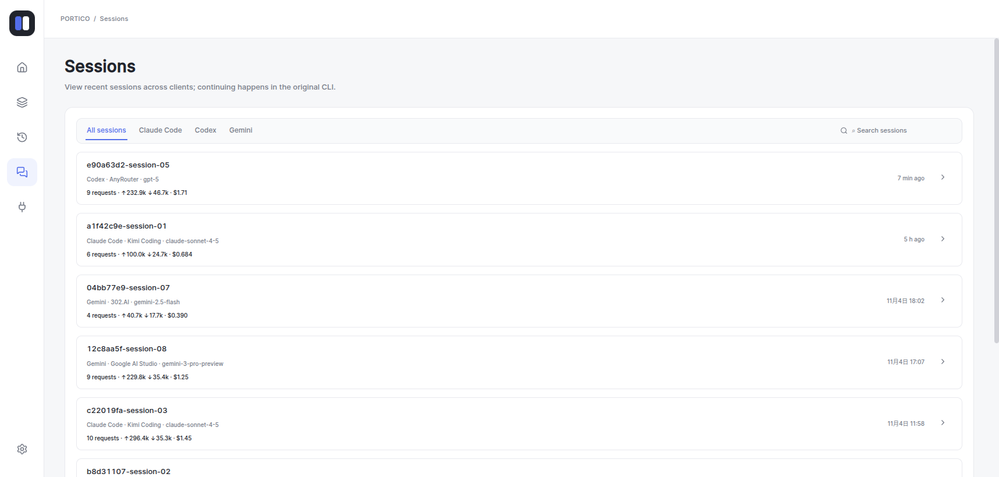
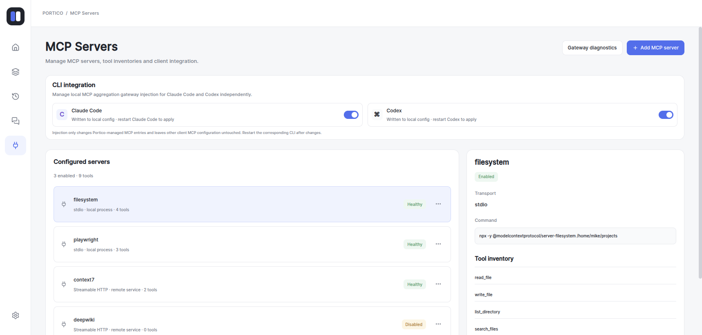
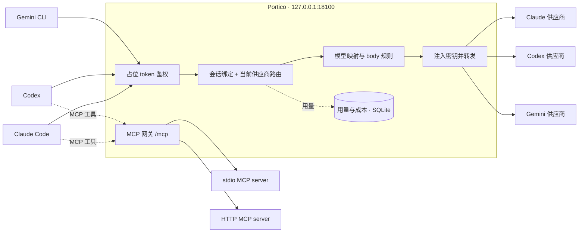

<div align="center">


# Portico

**AI 编程 CLI 的 API 供应商管理中心。**

[Claude Code](https://github.com/anthropics/claude-code) · [Codex](https://github.com/openai/codex) · [Gemini CLI](https://github.com/google-gemini/gemini-cli)

[下载](https://github.com/blueshark0/Portico/releases/latest) · [快速开始](#快速开始) · [服务器部署](#服务器部署无桌面) · [工作原理](#工作原理) · [MCP 网关](#mcp-网关) · [参与贡献](#参与贡献)

[English](README.md) · **简体中文**

[](https://github.com/blueshark0/Portico/actions/workflows/test.yml)
[](LICENSE)


</div>

Portico 位于你的 AI 编程 CLI 与它们的 API 供应商之间。后台服务 `portico-server` 在 `127.0.0.1:18100` 启动本地 relay，把各 CLI 指向这个地址，再将请求转发给你选定的供应商，同时提供会话感知的路由、模型重映射、逐请求的用量与成本统计，以及聚合的 MCP 端点。你可以在桌面应用里管理它；在没有桌面环境的机器上，用浏览器管理。

- **所有 CLI 共用一个本地地址。** 在应用内或用 <kbd>⌘K</kbd> / <kbd>Ctrl+K</kbd> 面板切换供应商，不必再改 CLI 配置文件。
- **路由行为可预期。** 每个 CLI 有一个当前供应商，会话始终跟随首次成功服务它的供应商。没有隐藏的重试链，也没有静默降级。
- **花多少一目了然。** 每个请求的 Token、缓存读写、估算成本、首响应耗时与总耗时都有记录。
- **透明转发。** 请求与响应（含 SSE 流）逐字节透传，只有 `model` 字段和你自己配置的 body 改写规则会修改报文。
- **谨慎对待你的配置。** Portico 只修改它管理的字段，保存原值，并在关闭接入时恢复。
- **桌面与无桌面都能用。** 同一个后端同时为桌面窗口和受令牌保护的 Web 界面提供服务，因此 Portico 也能运行在没有桌面环境的服务器上。

基于 [Wails 3](https://v3.wails.io)（Go）与 Vue 3 + TypeScript 构建。所有数据都保存在本机。

## 界面预览



<details>
<summary>更多截图：暗色模式、供应商管理、用量日志、会话、MCP 服务</summary>
<br />







</details>

## 功能特性

| | |
| --- | --- |
| **供应商管理** | 每个 CLI 独立的供应商档案，<kbd>⌘K</kbd> / <kbd>Ctrl+K</kbd> 快速切换，连通性测试，跨 CLI 复制档案，归档与恢复。 |
| **可预期的路由** | 会话绑定到首次成功服务它的供应商；切换当前供应商只影响新会话；绑定失效（供应商被删除、归档或不支持该模型）时自动清理并重新绑定。 |
| **模型控制** | 按供应商配置模型白名单（精确或通配符）、可保存可切换的**模型映射方案**（如 `claude-*` → `anthropic/claude-*`），以及请求体覆盖 / 条件替换规则。 |
| **网络** | 全局 HTTP 代理，供应商级 继承 / 自定义 / 直连 覆盖，以及显式开启的供应商级跳过 TLS 校验选项（用于本地抓包代理）。 |
| **用量与成本** | 逐请求日志（Token、缓存、成本、首响应、耗时、状态），含成功率、Token 构成与 7 天趋势的概览面板，会话级追踪，应用日志查看。 |
| **MCP 网关** | 把 stdio 与 Streamable HTTP 的 MCP server 聚合到单一端点（`/mcp`），工具按 `<server>__<tool>` 命名，支持上游调用超时、连通性测试与诊断，并可一键注入 Claude Code 与 Codex。 |
| **同步与偏好** | 可选的 WebDAV 同步（供应商档案与外观偏好），本地加密（scrypt + AES-256-GCM），恢复前自动本地备份；亮色 / 暗色 / 跟随系统主题，中英文界面。 |
| **桌面外壳** | 系统托盘（含亮暗图标），macOS 下可隐藏 Dock 图标。 |

## 支持的客户端

| CLI | relay 端点 | 受管理的配置字段 | MCP 注入 |
| --- | --- | --- | --- |
| **Claude Code** | `POST /v1/messages` | `~/.claude/settings.json` → `env.ANTHROPIC_BASE_URL`、`env.ANTHROPIC_AUTH_TOKEN` | `~/.claude.json` → `mcpServers.portico` |
| **Codex** | `POST /responses`、`POST /responses/compact` | `~/.codex/config.toml` → `model_provider`、`model_providers.portico.*`；`~/.codex/auth.json` → `OPENAI_API_KEY` | `~/.codex/config.toml` → `[mcp_servers.portico]` |
| **Gemini CLI** | `POST /gemini/v1beta/*`、`POST /gemini/v1/*` | `~/.gemini/.env` → `GOOGLE_GEMINI_BASE_URL`、`GEMINI_API_KEY` | —（可手动接入，见 [MCP 网关](#mcp-网关)） |

CLI 使用占位 token `portico` 向 relay 鉴权，**不会**写入你的真实密钥。Portico 在转发前剥离客户端凭证，只在发往上游的请求中注入所选供应商的 API key。relay 仅监听回环地址，不暴露到局域网。

## 安装

从 [**Releases**](https://github.com/blueshark0/Portico/releases/latest) 下载对应构建。

| 平台 | 资产 |
| --- | --- |
| Debian / Ubuntu · x86_64 | `portico-linux-amd64.deb` |
| Fedora / RHEL · x86_64 | `portico-linux-amd64.rpm` |
| Arch Linux · x86_64 | `portico-linux-amd64.pkg.tar.zst` |
| 其他 Linux · x86_64 | `portico-linux-amd64.AppImage` |
| Linux 服务器（无桌面）· x86_64 | `portico-server-linux-amd64.tar.gz`，见[服务器部署](#服务器部署无桌面) |

当前只发布 x86_64 Linux 版本，其他平台可[从源码构建](#从源码构建)。最低支持 Ubuntu 22.04，安装包需要 GTK 3 和 WebKit2GTK 4.1。

<!-- macOS 和 Windows 的发布暂时停用。恢复 release.yml 时一并恢复以下表格行和说明。
| macOS · Apple Silicon | `portico-macos-arm64.zip` |
| macOS · Intel | `portico-macos-amd64.zip` |
| Windows · x64 安装包 | `Portico-amd64-installer.exe` |
| Windows · x64 便携版 | `portico-windows-amd64-portable.zip` |

**macOS：** 解压后将 `Portico.app` 移入 `/Applications`。发布构建为 ad-hoc 签名、未经公证，Gatekeeper 可能阻止首次启动：

```sh
xattr -cr /Applications/Portico.app
```

或在「系统设置 → 隐私与安全性」中允许打开一次。

**Windows：** NSIS 安装包会在需要时引导安装 WebView2 运行时；便携版要求系统已安装 WebView2。便携版压缩包中的 `Portico.exe` 与 `portico-server.exe` 必须放在同一目录，桌面应用会从这里启动后端。
-->

## 快速开始

1. **添加供应商**：在「供应商 → 添加供应商」中填写名称、所属 CLI、API Base URL 与 API key。「测试连接」只检查网络可达性，不携带凭证、不消耗 API 额度。
2. **设为当前供应商**：点击「设为当前」，或在 <kbd>⌘K</kbd> / <kbd>Ctrl+K</kbd> 面板中选择。
3. **开启接入**：在工作台打开该 CLI 的「由 Portico 管理」开关。Portico 只改写上表列出的字段，并保存原值。
4. **若 CLI 已在运行则重启一次**，之后正常使用即可，所有请求都会经过 Portico。

此后切换供应商只需在应用内操作，无需再改配置、无需重启。注意：**已有会话会保持原供应商**，切换只影响新会话。若要让进行中的会话换供应商，使用「会话 → 解绑会话」，或在 CLI 中开新会话。

关闭开关即可恢复原值。供应商名称与 API key 保存在本机 `~/.portico/app.db`。

**退出桌面应用不会停止 relay。** 后端是独立进程，关闭窗口或退出应用后 CLI 仍可正常使用。如需一并停止，使用托盘菜单中的「退出并停止服务」。

## 服务器部署（无桌面）

在没有桌面环境的机器上，直接运行后端，用浏览器或终端界面管理。请以运行 CLI 的同一个用户身份运行：Portico 会修改该用户的 `~/.claude`、`~/.codex` 与 `~/.gemini`。

```sh
tar -xzf portico-server-linux-amd64.tar.gz
cd portico-server-linux-amd64
./portico-server --listen 0.0.0.0:18101   # relay 仍只监听 127.0.0.1:18100
./portico-server token show               # 显示访问令牌和登录链接
```

打开 `http://<服务器>:18101/?token=<令牌>`，或打开 `http://<服务器>:18101` 后粘贴令牌。令牌会保存在当前浏览器中，并从地址栏移除。

### 终端界面（TUI）

`portico-server tui` 提供基于同一套管理 API 的全屏终端界面，适合 SSH 登录后直接使用。在服务器本机运行时会自动找到运行中的后端，无需令牌：

```sh
./portico-server tui
PORTICO_ADMIN_TOKEN=<令牌> ./portico-server tui --url https://<服务器>:18101   # 从其他机器连接
```

TUI 覆盖日常操作：开关 CLI 接管、切换默认供应商、新增 / 编辑 / 归档供应商并测试连接、浏览请求日志、解除会话绑定、启停 MCP 服务与注入网关、跟随应用日志。模型映射、请求体改写、代理和配置同步仅在 Web UI 中提供。按 `?` 查看快捷键；退出 TUI 不会停止后端。

| | |
| --- | --- |
| **管理端口** | 默认 `127.0.0.1:18101`，用 `--listen` / `PORTICO_ADMIN_LISTEN` 修改。relay 始终只监听回环地址。 |
| **认证** | 来自其他主机的请求必须携带 `Authorization: Bearer <令牌>`。本机请求（回环地址且 `Host` 也是回环主机名）免令牌，因此 `ssh -L 18101:127.0.0.1:18101 server` 这类 SSH 隧道无需令牌即可使用。跨站的浏览器请求一律拒绝。 |
| **令牌** | 首次启动时生成于 `~/.portico/admin_token`（`0600`）。`portico-server token reset` 可重新生成，运行中的服务立即生效。 |
| **TLS** | `--tls-cert` / `--tls-key`（或 `PORTICO_ADMIN_TLS_CERT` / `PORTICO_ADMIN_TLS_KEY`）。未启用 TLS 时令牌以明文传输，对外开放端口时请使用 HTTPS 或隧道。 |
| **反向代理** | 让 `--listen` 保持回环地址，并开启 `--always-require-token`（`PORTICO_ADMIN_ALWAYS_TOKEN=1`）。否则同机的反向代理会被当作本机客户端。 |

如需常驻运行，安装随附的 systemd **用户**服务：

```sh
sudo install -m 0755 portico-server /usr/local/bin/
mkdir -p ~/.config/systemd/user && cp portico-server.service ~/.config/systemd/user/
systemctl --user daemon-reload && systemctl --user enable --now portico-server
loginctl enable-linger "$USER"   # 注销后保持运行
```

用 `systemctl --user edit portico-server` 覆盖监听地址或 TLS 设置（见服务文件中的注释）。

## 工作原理



Portico 由两个进程组成。**`portico-server`** 负责所有核心功能：relay、CLI 配置修改、MCP 网关和数据库，并在 `127.0.0.1:18101` 提供管理 API 与 Web 界面。**桌面应用**只是窗口、托盘图标和 Dock 入口：启动时复用已在运行的后端，否则拉起随应用分发的后端，然后在窗口中加载 Web 界面。其他机器上的浏览器使用的也是同一套界面。

每个请求经历五步：

1. **鉴权**：入站 token 必须是 `portico` 占位值（`Authorization`、`X-Api-Key`、`X-Goog-Api-Key` 或 `?key=`），否则返回 `401`。
2. **解析路由**：优先使用会话已绑定的供应商，否则使用该 CLI 的当前供应商。若供应商不允许所请求的模型，请求会被拒绝，而不是被悄悄改道。上游错误原样返回，且不会建立会话绑定。
3. **改写**：把请求的模型名映射为供应商自己的模型名，并应用你的 body 改写规则。请求体全程保持原始字节，未知字段不会丢失。
4. **转发**：剥离客户端凭证、注入供应商密钥，通过共享 HTTP client 按该供应商的代理与 TLS 设置发出请求；CLI 取消请求会同步取消上游请求。
5. **记录**：从 SSE `data:` 行或响应 JSON 中解析 Token 用量（只观察、不修改数据流），后台批量写入 `request_log.db`，成本按内置价格表估算。

### 对磁盘配置的修改

接入按 CLI 独立开启，且可逆。Portico 使用字段级补丁：Claude Code 用 raw JSON 编辑，Codex TOML 用 AST 偏移编辑，Gemini dotenv 用行级编辑，因此无关的键、顺序与注释都会保留。原值保存在 `~/.portico/platformproxy/<platform>.json`（权限 `0600`，因为快照可能包含旧 API key），关闭接入时恢复。

## MCP 网关

Portico 还能把你的 MCP server 聚合成一个 Streamable HTTP 端点，让各 CLI 共享同一份工具清单，而不是各自重复启动一批进程。

| | |
| --- | --- |
| **端点** | `http://127.0.0.1:18100/mcp`（POST / GET / DELETE） |
| **鉴权** | `Authorization: Bearer portico` |
| **上游类型** | `stdio`（命令、参数、环境变量）或 `http`（Streamable HTTP 地址、请求头） |
| **工具命名** | `<server>__<tool>`，例如 `context7__resolve-library-id`；超过 64 字符自动追加哈希后缀 |
| **安全** | 上游请求头只发往配置中指定的主机，重定向无法带走凭证；server 名称不允许包含 `__`。 |

1. 在「MCP 服务」页添加 server，测试连接并启用。
2. 打开 **Claude Code** 与 **Codex** 的 CLI 注入开关；只改动 `portico` 这一条目，你自己的 MCP 配置不受影响。重启对应 CLI 生效。
3. 通过「网关诊断」查看上游健康度、延迟、工具 Schema 与下游命名。

其他支持 Streamable HTTP 的 MCP 客户端，可使用上面的端点与 bearer 头手动接入。已启用的上游及其工具会即时对下游可见，上游的 `tools/list_changed` 通知会刷新注册表，无需重连。

## 数据与隐私

所有数据都在本机 `~/.portico/`：

| 路径 | 内容 |
| --- | --- |
| `app.db` | 供应商档案与 API key、偏好设置、WebDAV 设置、MCP server |
| `request_log.db` | 逐请求用量记录，保留 **30 天** |
| `session.db` | 会话 → 供应商绑定 |
| `hotkeys.db` | 快捷键设置 |
| `platformproxy/<platform>.json` | 受管 CLI 配置字段的原值（`0600`） |
| `admin_token` | 远程管理的访问令牌（`0600`） |
| `server.json` | 运行中后端的地址、PID 与版本（退出时删除） |
| `app.log` | 滚动应用日志（10 MB、5 个备份、14 天） |
| `sync-backups/` | 云端恢复前的本地快照 |

- **API key 以明文存储**在本机 SQLite 中，界面也会明文展示以便复制编辑，请注意本机账户与屏幕安全。
- **无遥测**：没有统计上报、没有更新探测、没有硬编码的服务端地址。网络请求只发往你配置的供应商、MCP 上游与 WebDAV 服务器。
- **不记录请求内容**：只保存结构化指标，不保存提示词、补全内容或原始 SSE 事件。成本为内置价格表估算的美元金额，不等于供应商账单。
- **管理端口默认只监听回环地址。** 对外开放需要你主动配置，且其他主机必须携带访问令牌。
- **WebDAV 同步可选**，未配置前不会启用；快照在上传前用你的口令在本机加密。

安全问题请私下报告，见 [SECURITY.md](SECURITY.md)。

## 常见问题排查

<details>
<summary><strong>CLI 收到 relay 返回的 401</strong></summary>

说明它的配置里已不再是 `portico` 占位 token，通常是被其他工具改写了。在工作台把该 CLI 的接入关闭再打开即可，只会修复受管字段，不影响其他设置。
</details>

<details>
<summary><strong>窗口提示无法连接 Portico 服务</strong></summary>

后端需要占用 `127.0.0.1:18100`（relay，固定）与 `127.0.0.1:18101`（管理端口）。检查是否有其他 relay 或程序占用了端口，然后查看 `~/.portico/app.log`，并在托盘菜单中选择「重新连接服务」。在 Windows 与 macOS 上，请确认 `portico-server` 与 Portico 可执行文件位于同一目录。
</details>

<details>
<summary><strong>退出 Portico 后 CLI 仍然可用</strong></summary>

这是预期行为：relay 运行在后台服务中。在托盘菜单中选择「退出并停止服务」，或运行 `curl -X POST -H 'Content-Type: application/json' http://127.0.0.1:18101/api/shutdown`。
</details>

<details>
<summary><strong>Web 界面反复要求输入令牌</strong></summary>

令牌已被重置或输入有误。在服务器上运行 `portico-server token show` 并使用输出的链接。部署在反向代理之后时，所有请求（包括你自己的）都需要令牌。
</details>

<details>
<summary><strong>切换了供应商，但会话仍在用旧的</strong></summary>

这正是会话粘性的预期行为。使用「会话 → 解绑会话」让它重新路由到当前供应商，或在 CLI 中开新会话。
</details>

<details>
<summary><strong>某个供应商被跳过，或模型被拒绝</strong></summary>

检查该供应商的模型白名单与当前启用的映射方案。白名单为空且无映射时接受所有模型；一旦配置了白名单，就只接受列出的模型。
</details>

<details>
<summary><strong>成本或 Token 数看起来不对</strong></summary>

成本来自内置的 LiteLLM 价格表，可能与供应商实际计费不同，尤其是缓存与推理 Token。总 Token = 输入 + 输出；缓存与推理 Token 可能已经包含在这两项中。
</details>

**调试日志：** 启动前设置 `PORTICO_DEBUG_RELAY=1` 可输出逐请求的 relay 详细日志。「用量日志 → 应用日志」可查看启动、MCP 连接与上游错误。

## 开发

### 环境要求

- **Go 1.26+**
- **Node.js 20.19+ 或 22.12+**（Vite 7 的要求），配合 **pnpm 9**
- **Wails 3.1.0 CLI**

  ```sh
  go install -tags gtk3 github.com/wailsapp/wails/v3/cmd/wails3@v3.1.0
  ```

- **仅 Linux：** `libgtk-3-dev` 与 `libwebkit2gtk-4.1-dev`

  ```sh
  sudo apt-get install -y libgtk-3-dev libwebkit2gtk-4.1-dev
  ```

### 从源码构建

```sh
git clone https://github.com/blueshark0/Portico.git
cd Portico

wails3 task build:server   # 后端 + 内嵌 Web 界面 → bin/portico-server（纯 Go，无需 cgo）
wails3 task run:server     # 构建并在前台运行
wails3 task dev            # 桌面外壳，会启动 bin/portico-server 作为后端
wails3 task build          # 构建当前平台的桌面应用与后端
wails3 task package        # 生产打包（.app / NSIS / AppImage + deb + rpm）
```

前端依赖与 bindings 由构建任务自动生成。前端仍通过 Wails 生成的 TypeScript bindings 调用后端，但调用经 HTTP 发往 `portico-server` 的 `POST /api/rpc/{Facade}.{Method}`，不走 Wails IPC。修改 Go 结构体或 facade 方法后，可手动重新生成：

```sh
wails3 task common:generate:bindings
```

新增 facade 时需同时登记到 `internal/app/bootstrap/container.go` 的 `Facades()` 与 `cmd/bindgen`（仅用于生成 bindings）。

**前端开发**：Vite 会把 `/api` 代理到运行中的后端（`PORTICO_ADMIN_URL`，默认 `http://127.0.0.1:18101`）。后端未运行或设置了 `VITE_PORTICO_MOCK=1` 时，UI 通过 mock transport 提供演示数据：

```sh
wails3 task run:server     # 可选：使用真实数据
cd frontend
pnpm install
pnpm dev                   # http://localhost:9245
```

### 检查

以下命令与 CI 在每次 push / PR 上执行的完全一致：

```sh
go vet ./...
go test -race -count=1 ./...

cd frontend
pnpm install --frozen-lockfile
pnpm run build        # vue-tsc 类型检查 + Vite 生产构建
```

Go 测试绝不能读写真实的 `~/.portico`，一律使用按测试隔离的数据库。修改 relay、会话缓存或 MCP 网关后务必跑 `go test -race`。

### 打包与发布

打包前更新构建元数据：

```sh
wails3 task common:update:build-assets
wails3 task package
```

在 macOS 上交叉编译 Windows 需要 `mingw-w64`（`brew install mingw-w64`）：

```sh
env ARCH=amd64 wails3 task windows:build
env ARCH=amd64 wails3 task windows:package   # 需要 makensis
```

推送 `v*` 标签会触发 [`.github/workflows/release.yml`](.github/workflows/release.yml)，构建 x86_64 Linux 桌面安装包和服务器压缩包，并发布 Release。`scripts/publish_release.sh <tag> [notes-file]` 是等价的本地入口。

## 项目结构

```
main.go                              桌面外壳入口（窗口、托盘、Dock）
cmd/portico-server/                  后端入口：relay、管理 API、Web 界面
cmd/bindgen/                         仅用于生成 TS bindings 的 facade 登记
internal/
  app/bootstrap/                     组合根、存储初始化与迁移
  app/desktop/                       窗口、托盘与 Dock 外壳
  app/sidecar/                       桌面 ↔ 后端：发现、拉起、停止 portico-server
  interfaces/http/relay/             回环 relay：鉴权、路由、转发、MCP 挂载
  interfaces/http/admin/             管理 API：令牌认证、facade RPC、静态 Web 界面
  interfaces/tui/                    终端界面（portico-server tui），管理 API 的客户端
  interfaces/wails/                  暴露给界面的 facade（经管理 API 的 RPC 提供）
  routing/                           供应商、路由档案、模型映射方案、连通性探测
  sessions/                          会话 → 供应商粘性（LRU + SQLite）
  observability/                     请求日志、Token 解析、统计、应用日志读取
  platformproxy/                     精细化 CLI 配置修改、MCP 注入与恢复
  mcpgateway/                        上游连接池、工具注册表、聚合
  configsync/                        加密的 WebDAV 配置同步
  hotkeys/                           快捷键存储
  shared/                            kernel 类型、存储、日志、服务信息、后台 worker
resources/model-pricing/             内置价格表与成本计算
frontend/                            Vue 3 + TypeScript + Vite + Tailwind UI
build/                               各平台打包配置
```

后端按 `internal/` 下的 bounded context 组织，每个 context 分为 `domain / application / infrastructure`，依赖方向向内（`interfaces → application → domain`）。新服务在 `internal/app/bootstrap/container.go` 中装配。前端状态由各功能 composable 管理，不使用状态管理框架。桌面外壳不链接任何后端包，只通过 HTTP 与 `portico-server` 通信。

## 参与贡献

欢迎贡献。

- **问题与想法**：使用 [bug 反馈](https://github.com/blueshark0/Portico/issues/new?template=bug_report.yml) 与 [功能建议](https://github.com/blueshark0/Portico/issues/new?template=feature_request.yml) 模板。较大的改动请先开 issue 讨论方案，再投入实现。
- **提交 PR 前**：跑完上面的[检查](#检查)。提交保持聚焦，使用 [Conventional Commits](https://www.conventionalcommits.org/) 前缀（`feat:`、`fix:`、`docs:`、`refactor:`、`test:`、`chore:`）。
- **面向用户的文案**需同时更新 `frontend/src/locales/en.json` 与 `zh.json`，保持键集合对称。
- **relay 改动**必须保持请求与响应的字节级透传，请扩充现有透传测试而不是削弱它们。
- **安全问题**请私下报告，不要开公开 issue，见 [SECURITY.md](SECURITY.md)。

## 致谢

- [Wails](https://v3.wails.io) — 桌面应用框架
- [BerriAI/litellm](https://github.com/BerriAI/litellm) — 内置[模型价格数据](resources/model-pricing/model_prices_and_context_window.json)的来源
- [modelcontextprotocol/go-sdk](https://github.com/modelcontextprotocol/go-sdk) — 网关背后的 MCP server 与 client 实现

Portico 是独立的开源项目，与 Anthropic、OpenAI、Google 无隶属关系，也未获其背书或赞助。Claude Code、Codex、Gemini 为各自所有者的商标。

## 许可证

[Apache License 2.0](LICENSE) © Portico contributors
